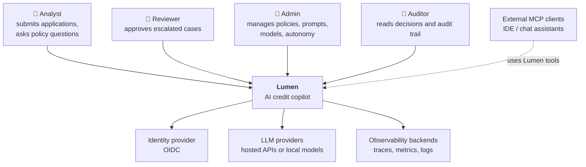

# 01 — System Context

Level 1 of the C4 model: Lumen as a single box, the people who use it and the systems it depends on.

| Element | Relationship | Spec |
|---|---|---|
| Analyst | Submits cases, reads recommendations, asks policy questions | FR-030, FR-011 |
| Reviewer | Decides escalated cases, overrides with reason | FR-050 |
| Admin | Configures policies, prompts, models, roles, autonomy | security-governance §5 |
| Auditor | Read-only access to decisions and audit trail | FR-052 |
| Identity provider | Authenticates users; roles mapped to RBAC | FR-051 |
| LLM providers | Text, vision and embedding models behind a port | ADR-0004 |
| Observability backends | Receive OpenTelemetry data | ADR-0010 |
| External MCP clients | Can reuse Lumen's MCP tools under the same permissions | ADR-0008 |

**Out of the boundary on purpose:** credit bureaus, core banking and payments. All data is synthetic (see `product.md` non-goals).
