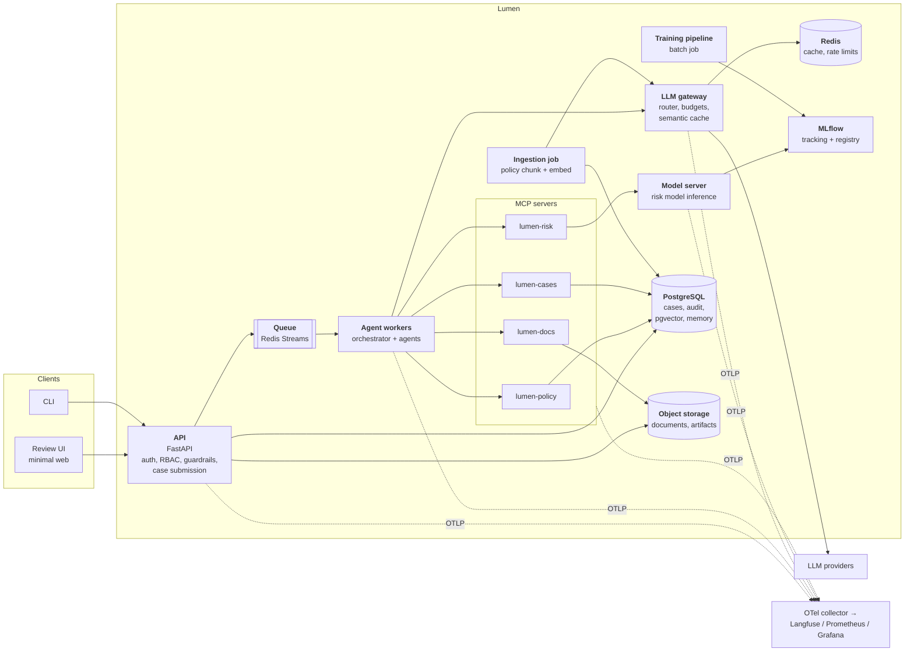

# 02 — Containers

Level 2 of the C4 model: the deployable units, their responsibilities and how they communicate.

| Container | Technology | Responsibility | Scales by |
|---|---|---|---|
| API | FastAPI | Auth, RBAC, input guardrails, idempotent submission, reads | Replicas (stateless) |
| Queue | Redis Streams | Decouple submission from processing; backpressure | — |
| Agent workers | Python | Run the orchestrator and agents per case | Replicas on queue depth |
| LLM gateway | Python module or service | Tier routing, fallback, token budgets, cost tracking, semantic cache | Replicas |
| MCP servers | MCP (Python SDK) | Expose policy search, risk scoring, document parsing, case actions | Replicas |
| Model server | FastAPI / MLflow serving | Low-latency risk model inference | Replicas |
| Ingestion job | Batch | Chunk, embed and index policy versions | On demand |
| Training pipeline | Batch | Train, evaluate and register risk models | On demand |
| PostgreSQL + pgvector | PostgreSQL | Cases, audit log, vectors, long-term memory | Vertical, read replicas |
| Object storage | S3 / MinIO | Documents and artifacts | Managed |
| MLflow | MLflow | Experiments and model registry | Single instance |

**Why a queue:** a full case takes tens of seconds and calls external models. Async processing keeps the API fast, absorbs spikes and allows retries without losing work (NFR-S03, NFR-R04).
