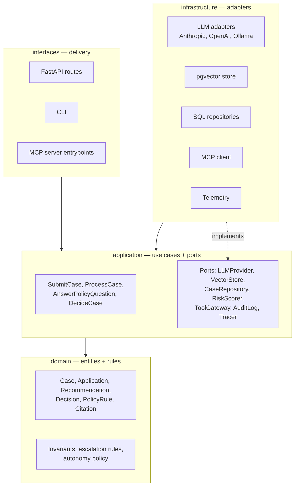
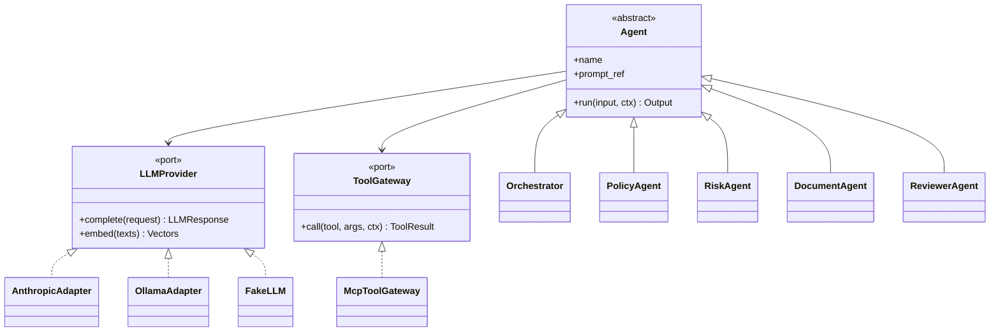

# 03 — Clean Architecture

Level 3 of the C4 model for the Python codebase. See ADR-0003.

## The dependency rule

Dependencies point **inward**. The domain knows nothing about frameworks, models, databases or HTTP.



## Where agents fit

Agents are **application services**: they orchestrate use cases through ports. Prompts and LLM calls are reached through the `LLMProvider` port; tools are reached through the `ToolGateway` port. This keeps agent logic testable with fakes.



## Module map

```
src/lumen/
├── domain/
│   ├── intake/          # Application, Document, ExtractedField
│   ├── policy/          # Policy, PolicyRule, Citation
│   ├── risk/            # RiskAssessment, ModelVersion
│   ├── decisioning/     # Case, Plan, Recommendation, Decision, escalation rules
│   └── governance/      # AuditEvent, Role, Permission
├── application/
│   ├── ports/           # Interfaces only
│   ├── use_cases/       # One class per use case
│   └── agents/          # Orchestrator and specialized agents
├── infrastructure/
│   ├── llm/             # Provider adapters, router, cache, budgets
│   ├── retrieval/       # Chunker, embedder, vector store, reranker
│   ├── persistence/     # Repositories, audit log
│   ├── tools/           # MCP client
│   ├── guardrails/      # Guardrail chain implementations
│   └── telemetry/       # OpenTelemetry setup
└── interfaces/
    ├── api/             # FastAPI
    ├── cli/
    └── mcp_servers/     # lumen-policy, lumen-risk, lumen-docs, lumen-cases
```

## Design patterns used

| Pattern | Where | Why |
|---|---|---|
| Ports and Adapters | `application/ports` ↔ `infrastructure` | Swap providers without touching use cases |
| Strategy | Model router, chunking strategies, rerankers | Choose behavior by configuration and evals |
| Chain of Responsibility | Guardrails | Composable checks that pass, transform or block |
| Repository | Persistence | Domain-oriented data access |
| Factory | Agent and provider creation from config | Centralized wiring |
| Decorator | Retry, cache, tracing around `LLMProvider` | Cross-cutting concerns without changing adapters |
| State | Case lifecycle | Explicit, validated transitions |
