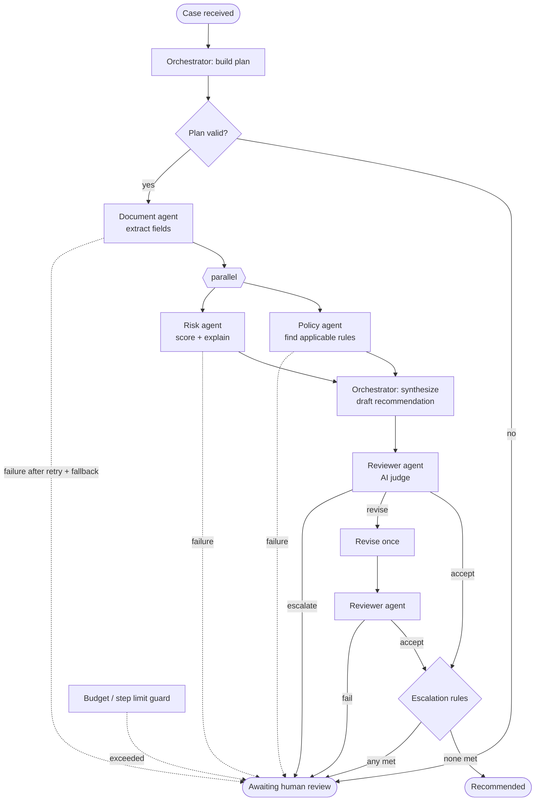
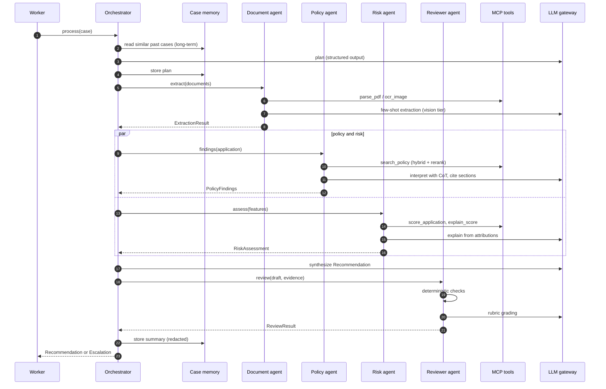
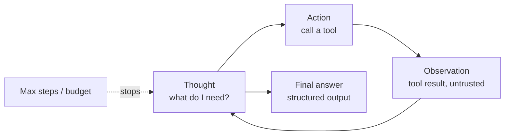
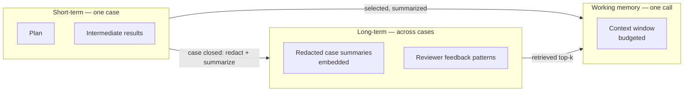

# 04 — Agent Workflow

How a case moves through the multi-agent system. Specs: `agents.md`, FR-032–FR-034, FR-040, FR-050.

## Orchestration graph

The Orchestrator first builds a **plan**, then executes it. Independent steps run in parallel. Every path ends either in a recommendation or an escalation, never in a silent failure.

## Sequence of a case

## ReAct loop inside an agent

## Prompting techniques by agent

| Agent | Technique | Why |
|---|---|---|
| Orchestrator | Plan-and-execute + ReAct | Explicit, auditable plan; adaptive when a step fails |
| Document | Few-shot, structured output, vision | Examples anchor field formats and units |
| Policy | RAG + Chain-of-Thought | Rules need interpretation; reasoning is checked against citations |
| Risk | Zero-shot, tool use | The model only explains numbers returned by the tool |
| Reviewer | Rubric-based LLM-as-a-judge | Repeatable grading with explicit criteria |

## Memory

