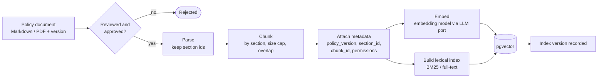
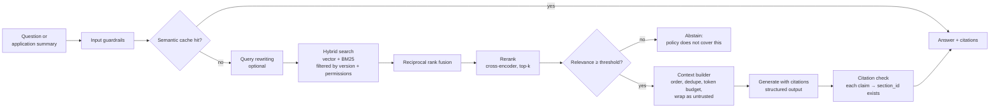

# 05 — RAG Pipeline

How the credit policy becomes grounded, cited answers. Specs: FR-010–FR-012, EV-01–EV-03, ADR-0007.

## Ingestion

## Query

## Design choices

| Choice | Default | Evaluated by |
|---|---|---|
| Chunking | Section-aware, ~400 tokens, 15 % overlap | M-R01, M-R02 |
| Retrieval | Hybrid (vector + BM25) with RRF | M-R01–M-R03 vs. vector-only |
| Reranking | Cross-encoder over top 20 → top 5 | M-R04 (rerank uplift) |
| Abstention threshold | Tuned on DS-02 | M-Q07 |
| Context budget | Max share of the window for retrieved text | M-C02, M-Q03 |

Each default becomes an ADR once measured.
