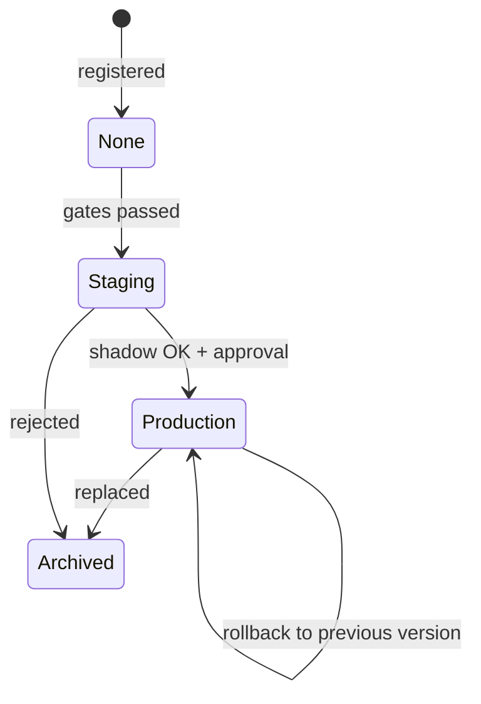

# 06 — ML Lifecycle (MLOps)

How the risk model is trained, validated, promoted, served and monitored. Specs: FR-020–FR-022, M-ML*, M-F*, ADR-0009.

```mermaid
flowchart LR
    subgraph Data
        RAW[("Raw dataset<br/>public / synthetic")] --> VALD["Data validation<br/>schema, ranges, nulls"]
        VALD --> FEAT["Feature pipeline<br/>no sensitive attributes"]
        FEAT --> SPLIT["Train / validation / holdout<br/>dataset hash recorded"]
    end

    subgraph Train["Experimentation"]
        SPLIT --> TRN["Train candidates<br/>logistic regression, XGBoost"]
        TRN --> TRK["MLflow tracking<br/>params, metrics, artifacts"]
        TRK --> EVAL["Evaluate on holdout<br/>AUC, KS, Brier, calibration"]
        EVAL --> FAIR["Fairness evaluation<br/>disparate impact, equal opportunity"]
    end

    subgraph Release
        FAIR --> GATE{"M-ML* and M-F*<br/>thresholds met?"}
        GATE -- no --> TRN
        GATE -- yes --> REG["Register model<br/>version N, stage: staging"]
        REG --> SHADOW["Shadow scoring<br/>compare with production"]
        SHADOW --> APPROVE{"Admin approval"}
        APPROVE -- yes --> PROD["Stage: production"]
    end

    subgraph Serve["Serving and monitoring"]
        PROD --> MS["Model server<br/>behind MCP lumen-risk"]
        MS --> MON["Monitoring<br/>PSI drift, score distribution,<br/>latency"]
        MON -- drift alert --> RAW
    end
```

## Model registry stages

## Reproducibility contract

Every registered model version records: code commit, dataset hash, feature list, hyperparameters, metrics, fairness report and the environment (pinned dependencies). Any version can be retrained and must reproduce its metrics within tolerance.

## Training vs. inference

| Aspect | Training | Inference |
|---|---|---|
| Runs | Batch, on demand or on drift | Online, per case |
| Compute | CPU (tabular); GPU only if needed | CPU, low latency (NFR-P03) |
| Output | Model artifact + reports | Probability of default, risk band, attributions |
| Owner | Training pipeline | Model server via MCP |
