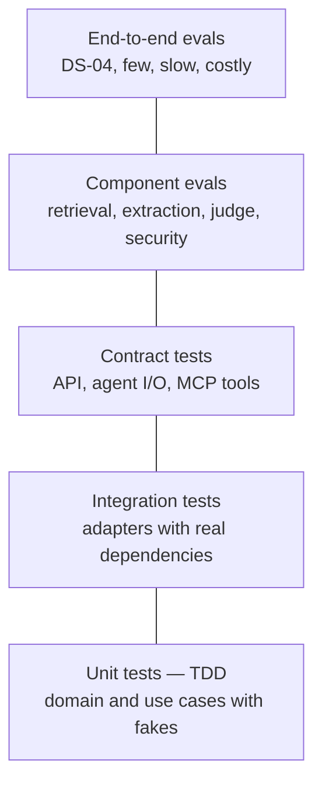
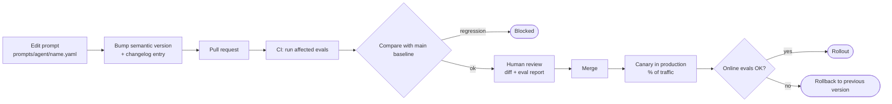
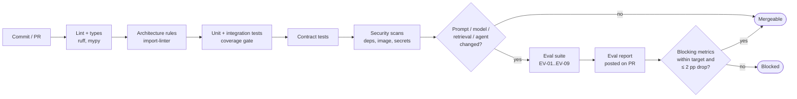

# 07 — LLMOps and Quality

How prompts, models and agent code change safely. Specs: FR-002, `evals.md`, M-Q*, NFR-M02.

## Test pyramid for an AI system

Lower layers are deterministic and run on every commit. Upper layers call models, so they run on relevant changes and are seeded and pinned for repeatability.

## Prompt lifecycle

## CI quality gates

## What is versioned

| Artifact | Where | Version format |
|---|---|---|
| Prompts | `prompts/` | Semantic version per prompt |
| Tool descriptions | MCP servers | Contract version |
| Model routing config | `config/models.yaml` | Git commit |
| Eval datasets | `evals/datasets/` | Dataset version + hash |
| Risk model | MLflow registry | Model version |
| Policy | Ingestion index | Policy version |

Every case stores the versions it used, so any output can be reproduced (GOV-04).
