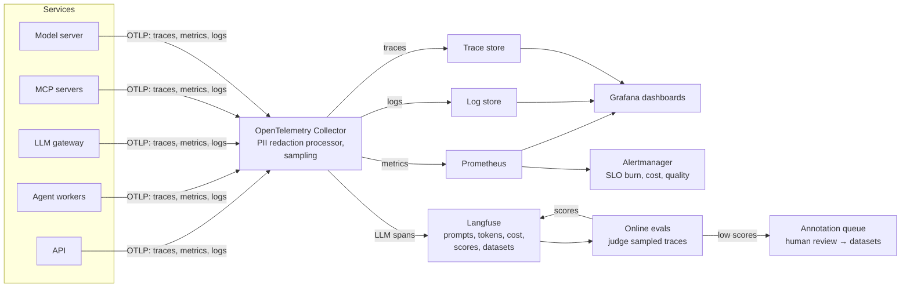

# 09 — Observability

How every request is traced, measured and alerted on. Specs: FR-060, NFR-O01–NFR-O04, `metrics.md`, ADR-0010.

## Telemetry flow

## Anatomy of a trace

One trace per case. Every span carries `case_id`, `trace_id`, actor and versions. LLM spans follow the OpenTelemetry GenAI semantic conventions.

```mermaid
gantt
    title Trace for one case (illustrative timings)
    dateFormat  s
    axisFormat  %Ss
    section API
    POST /cases + guardrails      :a1, 0, 1s
    section Orchestrator
    plan (LLM mid)                 :a2, 1, 3s
    synthesize (LLM mid)           :a6, 16, 4s
    section Document agent
    parse_pdf (MCP)                :a3, 4, 2s
    extract (LLM vision)           :a4, 6, 5s
    section Policy agent
    search_policy (MCP)            :b1, 11, 1s
    interpret (LLM small)          :b2, 12, 3s
    section Risk agent
    score_application (MCP)        :c1, 11, 1s
    explain (LLM small)            :c2, 12, 2s
    section Reviewer
    deterministic checks           :d1, 20, 1s
    judge (LLM reasoning)          :d2, 21, 4s
```

## Dashboards

| Dashboard | Panels | Metrics |
|---|---|---|
| Service health | Availability, latency p50/p95/p99, error rate, queue depth | M-O01–M-O05 |
| Cost | Cost per case and per question, tokens by agent and model, cache hit rate, routing mix | M-C01–M-C05 |
| Quality | Online groundedness, citation validity, schema validity, judge scores over time | M-Q03, M-Q04, M-Q08 |
| Human-in-the-loop | Escalation rate, override rate, time to decision, feedback | M-H01–M-H04 |
| Safety | Guardrail blocks by rule, injection attempts, RBAC denials | M-S01–M-S04 |
| Risk model | Score distribution, PSI per feature, latency | M-ML04, M-ML05 |

## Alerts

| Alert | Condition | Action |
|---|---|---|
| SLO burn | Error budget burn rate > 2× over 1 h | Page on-call |
| Cost anomaly | Cost per case +30 % vs. 7-day baseline | Notify; check routing and cache |
| Quality drop | Online groundedness below target for 1 h | Notify; consider prompt rollback |
| Provider degradation | Fallback rate > 5 % | Notify; verify provider status |
| Drift | PSI > 0.2 on any key feature | Notify; trigger retraining review |
