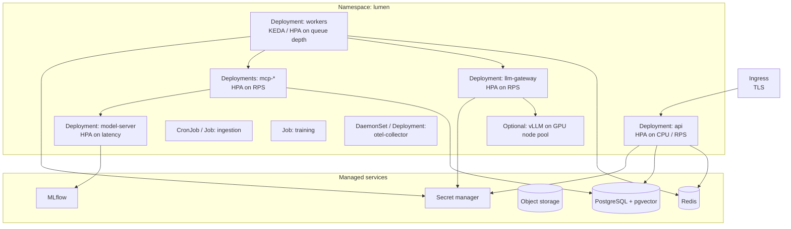
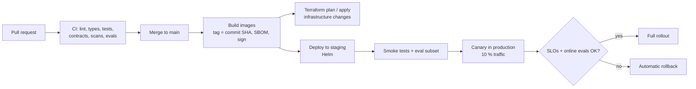

# 10 — Deployment

How Lumen runs locally, in CI and on Kubernetes. Specs: NFR-S01–NFR-S04, NFR-M04.

## Environments

| Environment | Purpose | How it runs | LLMs |
|---|---|---|---|
| Local | Development | `docker compose up` | Local (Ollama) or hosted with own key |
| CI | Tests and evals | Ephemeral containers | Fakes for unit tests; pinned models for evals |
| Staging | Pre-production, canary source | Kubernetes namespace | Hosted |
| Production | Real traffic | Kubernetes namespace | Hosted + optional self-hosted |

## Kubernetes topology



## Scaling strategy

| Component | Bottleneck | Strategy |
|---|---|---|
| API | Requests per second | Stateless replicas; rate limits per user |
| Workers | Concurrent cases, external LLM latency | Scale on queue depth; async I/O; per-provider concurrency limits |
| LLM gateway | Provider rate limits, cost | Routing to cheaper tiers, semantic cache, fallback providers, request batching |
| Self-hosted inference | GPU memory and throughput | vLLM continuous batching, KV cache, quantization; GPU node pool scales to zero when idle |
| Model server | CPU latency | Small model, replicas |
| PostgreSQL | Writes (audit), vector queries | Connection pooling, read replicas, index tuning; dedicated vector engine if needed (ADR-0007) |

## CI/CD



## Infrastructure as Code

```
infra/
├── docker/          # Dockerfiles per service
├── compose/         # docker-compose for local development
├── helm/lumen/      # Helm chart: deployments, HPA, config, secrets refs
└── terraform/
    ├── modules/     # network, cluster, database, storage, observability
    └── envs/        # staging, production
```
