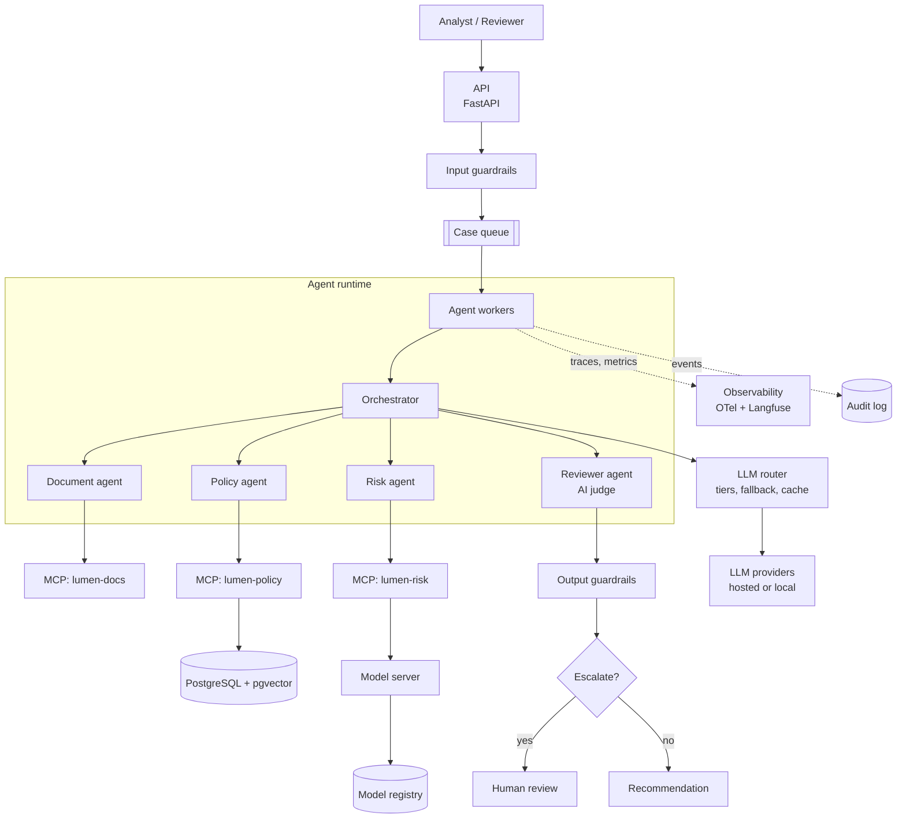

# Architecture

This folder describes how Lumen is built. It follows the **C4 model** (context → containers → components) and adds views for the AI-specific concerns: agent orchestration, retrieval, the ML lifecycle, LLMOps, security, observability and deployment.

All diagrams are written in [Mermaid](https://mermaid.js.org/) so they are versioned with the code and rendered by GitHub.

| # | View | Answers |
|---|---|---|
| 01 | [System context](01-system-context.md) | Who uses Lumen and what external systems does it depend on? |
| 02 | [Containers](02-containers.md) | What are the deployable units and how do they talk? |
| 03 | [Clean Architecture](03-clean-architecture.md) | How is the code layered and where do dependencies point? |
| 04 | [Agent workflow](04-agent-workflow.md) | How do agents plan, act, review and escalate? |
| 05 | [RAG pipeline](05-rag-pipeline.md) | How is the policy ingested, retrieved and cited? |
| 06 | [ML lifecycle](06-ml-lifecycle.md) | How is the risk model trained, registered, served and monitored? |
| 07 | [LLMOps and quality](07-llmops-quality.md) | How are prompts versioned and changes gated by evals? |
| 08 | [Security and trust boundaries](08-security.md) | Where is untrusted data, and what protects each boundary? |
| 09 | [Observability](09-observability.md) | How is every request traced, measured and alerted on? |
| 10 | [Deployment](10-deployment.md) | How does it run locally, in CI and on Kubernetes? |

## Architecture at a glance

## Key decisions

The reasoning behind the structure lives in the ADRs: [`specs/adr/`](../../specs/adr/). The most relevant for these views are ADR-0003 (Clean Architecture), ADR-0004 (LLM port and routing), ADR-0006 (orchestration), ADR-0008 (MCP) and ADR-0011 (human-in-the-loop).
