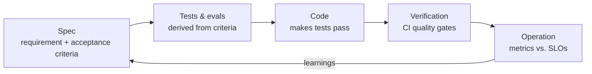

# Specifications

This folder is the **source of truth** for Lumen. Code, tests, evals, prompts, dashboards and data analysis are derived from the documents here. If the code and a spec disagree, the spec wins until it is changed through review.

## Spec-Driven Development (SDD)

1. **Write or update the spec** with an ID and testable acceptance criteria.
2. **Derive tests and evals** from the acceptance criteria. Each test references the spec ID it covers.
3. **Implement** the smallest change that satisfies the tests.
4. **Verify** in CI: tests, contract checks, eval thresholds, security suite.
5. **Operate** and compare production metrics against the targets in [`metrics.md`](metrics.md). Gaps become new or updated specs.

## Index

| Document | What it defines |
|---|---|
| [`product.md`](product.md) | Problem, users, scope, non-goals, core flow |
| [`functional-requirements.md`](functional-requirements.md) | What the system must do (`FR-*`) |
| [`non-functional-requirements.md`](non-functional-requirements.md) | Quality attributes and SLOs (`NFR-*`) |
| [`domain-model.md`](domain-model.md) | Bounded contexts, entities, ubiquitous language |
| [`agents.md`](agents.md) | Each agent's role, tools, I/O, autonomy and failure modes (`AG-*`) |
| [`contracts/`](contracts/) | API, agent I/O and MCP tool contracts |
| [`metrics.md`](metrics.md) | Product, quality, cost, operational and ML metrics (`M-*`) |
| [`evals.md`](evals.md) | Evaluation datasets, judges, thresholds and gates (`EV-*`) |
| [`security-governance.md`](security-governance.md) | Threat model, guardrails, RBAC, audit, HITL, fairness (`SEC-*`, `GOV-*`) |
| [`roadmap.md`](roadmap.md) | Phases with entry and exit criteria |
| [`adr/`](adr/) | Architecture Decision Records |

## Conventions

- **IDs are stable.** Never reuse or renumber an ID. Deprecate instead.
- **Priority** uses MoSCoW: `Must`, `Should`, `Could`, `Won't (now)`.
- **Status** of a spec item: `Draft` → `Accepted` → `Implemented` → `Verified` (or `Deprecated`).
- **Traceability.** Tests, evals and prompts reference spec IDs, e.g. `# covers: FR-012, EV-003`.
- **Change process.** Spec changes go through pull request review like code. Changes to an `Accepted` item that affect architecture require an ADR.
- **Language.** Specs are written in English, in plain sentences, using the ubiquitous language in [`domain-model.md`](domain-model.md).
