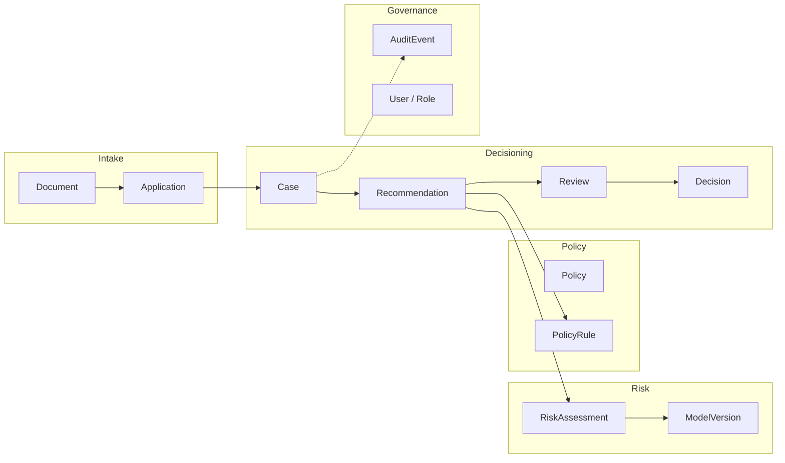
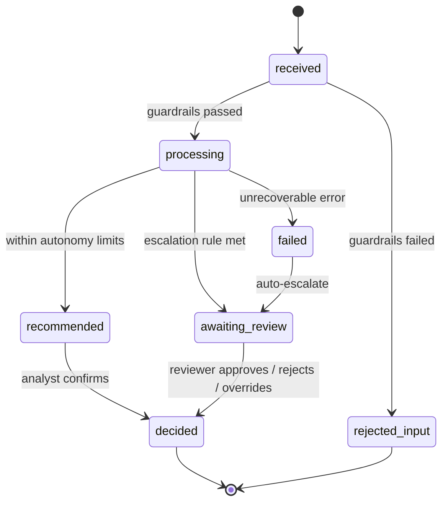

# Domain Model

## Bounded contexts

| Context | Responsibility | Owns |
|---|---|---|
| **Intake** | Receive applications and documents, extract data | Application, Document, ExtractedField |
| **Policy** | Store, version and retrieve credit policy rules | Policy, PolicyRule, Citation |
| **Risk** | Score applications with the ML model | RiskAssessment, ModelVersion |
| **Decisioning** | Orchestrate the case and produce decisions | Case, Plan, Recommendation, Review, Decision |
| **Governance** | Identity, permissions, audit | User, Role, AuditEvent |

## Ubiquitous language

| Term | Definition |
|---|---|
| **Application** | A request for credit by a business: amount, term, purpose and business data |
| **Document** | A file attached to an application (balance sheet, bank statement, registration) |
| **ExtractedField** | A value extracted from a document, with confidence and source location |
| **Case** | The unit of work that carries an application through the workflow |
| **Plan** | The ordered list of steps the Orchestrator intends to execute for a case |
| **Policy** | A versioned credit policy document |
| **PolicyRule** | An identifiable section of a policy (`section_id`) that can be cited |
| **Citation** | A reference from a claim to a PolicyRule or a Document location |
| **RiskAssessment** | The model output for an application: probability of default, risk band, top factors |
| **ModelVersion** | A registered, immutable version of the risk model |
| **Recommendation** | The system's proposed outcome with confidence, rationale and citations |
| **Review** | The AI judge's or a human reviewer's assessment of a recommendation |
| **Decision** | The final outcome of a case, always attributable to a human or an explicit autonomy rule |
| **Escalation** | Moving a case to human review |
| **Autonomy level** | What the system may do without a human for a given case |
| **AuditEvent** | An immutable record of an action, its actor and its context |

## Case lifecycle

## Key invariants

1. A `Decision` always has an accountable actor: a human user or an explicit autonomy rule version.
2. A `Recommendation` with outcome `reject` can never become a `Decision` without human approval.
3. Every claim in a `Recommendation` rationale has at least one `Citation`.
4. An `ExtractedField` below the confidence threshold is `missing`, never guessed.
5. `AuditEvent`s are append-only.
6. A `Case` records the exact versions used: policy, prompts, risk model, LLM models.
