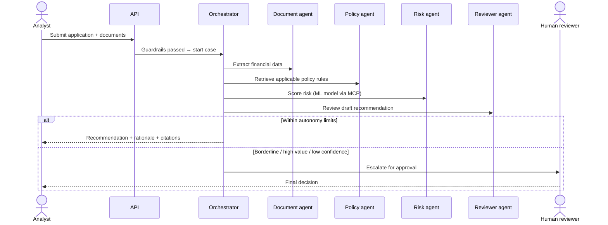

# Product Specification

## 1. Problem

Credit analysts evaluating small and medium business (SMB) loan applications spend most of their time on repetitive work: reading financial documents, looking up the applicable credit policy rules and writing a justification. Decisions vary between analysts, rationales are inconsistent, and it is hard to audit why a decision was made.

## 2. Solution

Lumen is an AI copilot that prepares a **decision recommendation** for each application: extracted financial data, a risk score, the applicable policy rules with citations, and a written rationale. A human analyst stays accountable for the final decision. Low-risk, policy-compliant cases can be fast-tracked; borderline or high-impact cases are always escalated.

## 3. Users and roles

| Role | Goal | Main actions |
|---|---|---|
| **Analyst** | Decide applications faster and more consistently | Submit applications, review recommendations, ask policy questions |
| **Reviewer** | Approve escalated cases | Approve, reject or override recommendations with a reason |
| **Admin** | Operate and govern the system | Manage policies, prompts, models, roles and autonomy settings |
| **Auditor** | Verify decisions after the fact | Read-only access to decisions, rationales and audit trail |

## 4. Core flow

## 5. Scope

### In scope

- SMB loan applications with a fixed, small set of fields and document types.
- A single synthetic credit policy document (versioned).
- A risk model trained on a public or synthetic dataset.
- Policy Q&A for analysts (RAG over the policy).
- Human-in-the-loop approval workflow.
- Full observability, evaluation, governance and deployment tooling.

### Non-goals

- Real customer data. All data is public or synthetic.
- Real lending, payments or integrations with credit bureaus.
- A polished end-user UI. An API, a CLI and a minimal review screen are enough.
- Optimizing the risk model for business performance. It needs to be correct and well-operated, not state of the art.

## 6. Success criteria

| Outcome | Measured by |
|---|---|
| Recommendations are accurate | Decision agreement with golden dataset (see `M-Q01`) |
| Recommendations are grounded | Groundedness and citation accuracy (see `M-Q03`, `M-Q04`) |
| The system is safe | Prompt-injection suite pass rate, zero PII leaks (see `M-S01`, `M-S02`) |
| The system is affordable | Cost per application within budget (see `M-C01`) |
| The system is operable | SLOs met, every request traceable end to end (see `NFR-*`) |
| The system is fair | Fairness metrics within thresholds (see `M-F01`) |
