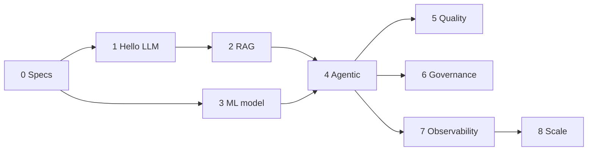

# Roadmap

Each phase has entry criteria (what must exist before starting) and exit criteria (definition of done). A phase is done only when its specs are `Verified`.

| Phase | Goal | Entry criteria | Exit criteria |
|---|---|---|---|
| **0. Specs & foundation** | Documented, buildable skeleton | — | Specs and initial ADRs accepted; architecture diagram; repo skeleton with Clean Architecture layers; CI running lint, types and tests |
| **1. Hello LLM** | One working, observable LLM call | Phase 0 | FR-001–FR-003 verified; prompts versioned; token and cost recorded; provider switchable by config |
| **2. RAG** | Grounded policy Q&A | Phase 1 | FR-010–FR-012 verified; EV-01–EV-03 passing; chunking and rerank decisions recorded in ADRs |
| **3. ML model** | Trained, registered, served risk model | Phase 0 | FR-020–FR-022 verified; experiments tracked; model registered; M-ML* and M-F* met; served via MCP |
| **4. Agentic** | End-to-end case workflow | Phases 2 and 3 | FR-030–FR-034 verified; plan stored per case; step and budget limits enforced |
| **5. Quality** | Measured, gated quality | Phase 4 | FR-040 verified; EV-04, EV-05, EV-07 in CI as blocking gates; regression policy active |
| **6. Governance** | Safe and accountable | Phase 4 | FR-050–FR-053 verified; EV-06 and EV-08 passing; RBAC and audit trail enforced |
| **7. Observability** | Operable in production | Phase 4 | FR-060–FR-061 verified; dashboards and alerts for M-O*, M-C*, M-Q*; online evals running |
| **8. Scale** | Deployable and scalable | Phase 7 | Containers, Helm, Terraform; autoscaling; load test meets NFR-S*; caching and routing meet NFR-C* |

